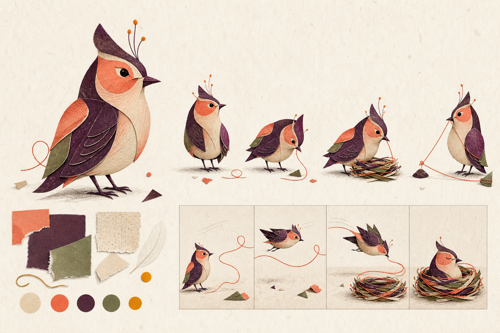
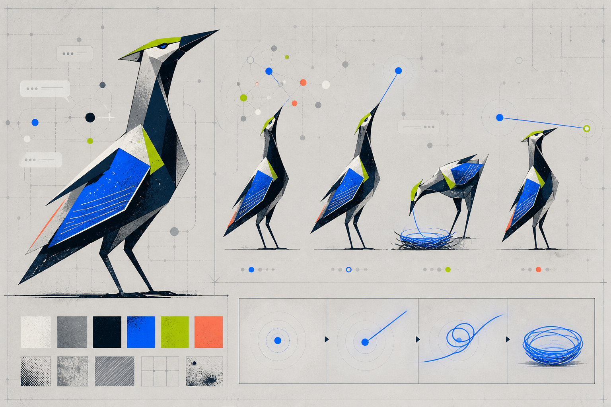
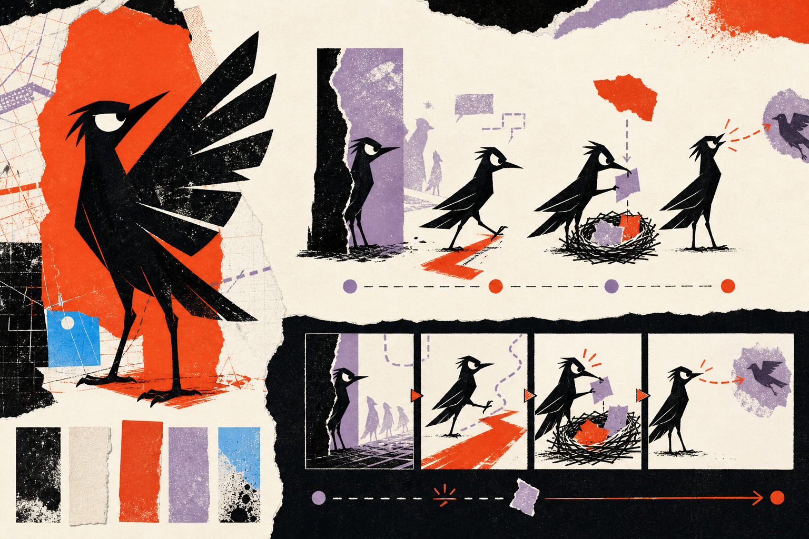

# «Контур» — три визуальных направления

> ## Исторический документ: визуальное решение отменено 2026-08-07
>
> Нельзя использовать выбранную здесь «Карту сигналов» как актуальный стиль.
> Владелец отверг текущий визуальный язык V5; следующему агенту нужно сначала
> представить новые направления по `CURSOR_HANDOFF_2026-08-07.md`.

Статус: **принято пользователем 6 августа 2026 года**  
Дата: 6 августа 2026 года  
Основание: принятые `PRODUCT_DIRECTION_V1.md` и `EXPERIENCE_SPEC_V1.md`

Эти изображения — не готовые материалы приложения. Они нужны, чтобы выбрать
характер будущей визуальной системы до отрисовки птиц, экранов и анимаций.

## 1. Что должна выражать новая система

«Контур» должен выглядеть как самостоятельный молодой продукт, который:

- помогает спокойно войти в уже идущий разговор;
- показывает нити между вопросом, ответом и следующим шагом;
- относится к человеку с уважением и не говорит с ним как с ребёнком;
- сохраняет живую птицу, но не назначает ей профессию;
- не похож на казино, таблицу достижений или служебный кабинет;
- хорошо читается на небольшом экране и не требует тяжёлой графики.

Общий образ для всех трёх вариантов — **птица замечает нить разговора, следует
за ней и складывает полезный результат в гнездо**.

## 2. От чего мы уходим

В работающей версии сейчас:

- одна округлая форма птицы для всех людей;
- различия в основном создаются очками, беретом, галстуком и другими
  профессиональными аксессуарами;
- тёмный фон, полупрозрачные карточки и оранжевый игровой акцент;
- развитие выражено валютой, яйцами, окрасками и рейтингом.

Для нового направления этого недостаточно. Птица должна быть узнаваема по
форме и движению, а развитие — по изменению её отношения к нити, гнезду и
другим участникам.

## 3. Визуальный контекст ЦУ

На актуальных страницах ЦУ заметны:

- высокий контраст чёрного и белого;
- яркий синий и коралловый как акценты;
- крупная прямая типографика и нумерованные смысловые блоки;
- соединение образования, технологий, дизайна, практики и сообщества.

«Контур» может поддержать ясность и смелый масштаб этого языка, но не должен
копировать логотип, точную раскладку страниц или выдавать себя за официальный
продукт университета.

Официальные страницы, использованные как контекст:

- [бакалавриат ЦУ](https://cu.ru/bachelor);
- [Школа дизайна ЦУ](https://cu.ru/bachelor/design);
- [мероприятия ЦУ](https://event.cu.ru/).

## 4. Направление А — «Живое гнездо»

### Характер

Тёплая редакционная иллюстрация из бумаги, карандашной фактуры и простых
цветных фрагментов. Птица любопытная и внимательная, но не младенческая.

### Что означает движение

1. Птица замечает свободную нить.
2. Следует за ней через разговор.
3. Складывает нить и найденные фрагменты в гнездо.
4. Успокаивается рядом с сохранённым результатом.

Движение мягкое: нить чуть запаздывает за птицей, бумажные фрагменты
подтягиваются к гнезду, после завершения остаётся едва заметное дыхание.

### Как будет выглядеть приложение

- светлый тёплый фон;
- карточки как отдельные бумажные листы без стеклянного блеска;
- рукотворные разделители и цветные нити вместо множества значков;
- основная кнопка коралловая, состояния — сливовые и зелёные;
- небольшие несовершенства формы создают ощущение живого предмета.

### Сильные стороны

- лучше всего снижает тревогу первого шага;
- делает гнездо личным и ценным;
- резко отличается от обычных технологических приложений.

### Риски

- может показаться слишком спокойным или «книжным»;
- фактуру трудно сохранить чистой на слабом экране;
- сложнее сделать лёгкую и недорогую анимацию;
- при неудачной доработке птица станет слишком милой и детской.

## 5. Направление Б — «Карта сигналов»

### Характер

Ясная графическая система на стыке редакционной иллюстрации и карты связей.
Птица собрана из крупных плоскостей и выражает внимание наклоном головы и
положением корпуса.

### Что означает движение

1. В поле появляется спокойный импульс.
2. Птица выделяет одну точку среди шума.
3. Точка вытягивается в нить и сворачивается в контур гнезда.
4. Из гнезда появляется связь со следующим узлом.

Основное движение короткое и точное: импульс — линия — петля — устойчивый
контур. Без сложной физики, прыгающих наград и бесконечных фоновых эффектов.

### Как будет выглядеть приложение

- светло-серый или почти белый фон;
- тонкая сетка только там, где она помогает увидеть связь;
- крупные тёмные заголовки, синий основной путь, зелёный подтверждённый
  результат, коралловый незавершённый шаг;
- карточки без лишнего объёма, состояния соединяются линией;
- птица остаётся главным живым элементом на фоне строгой системы.

### Сильные стороны

- лучше всего объясняет назначение «Контура»;
- хорошо читается в маленьком Telegram Mini App;
- проще переводится в SVG и короткие движения;
- естественно связывает чат, личное гнездо и следующий шаг;
- близко к технологическому и дизайнерскому контексту ЦУ, не копируя его.

### Риски

- без смягчения может стать холодным и служебным;
- нынешний длинношеий силуэт выглядит чуть отстранённым;
- сетка и узлы могут создать ложное впечатление сложной аналитической системы.

### Что нужно поправить после выбора

- сделать птицу компактнее и теплее, сохранив угловатый силуэт;
- убрать из фона всё, что похоже на наблюдение за сетью людей;
- оставить одну рабочую нить, а не множество декоративных связей;
- проверить сочетание синего и зелёного при нарушениях цветового восприятия.

## 6. Направление В — «Видимый след»

### Характер

Смелая журнальная графика: рваная бумага, крупные чёрные формы, один яркий
след. Птица независимая и немного дерзкая.

### Что означает движение

1. Птица остаётся у края общего потока.
2. Находит отмеченную дорогу и делает шаг.
3. Прикрепляет полезный фрагмент к гнезду.
4. Оставляет видимый след, которым может воспользоваться другой человек.

Движение строится на быстрых сменах кадра, печатных отметках и линии, которая
резко встаёт на место. Оно выразительное, но должно полностью останавливаться
при включённом уменьшении движения.

### Как будет выглядеть приложение

- тёплый белый фон и крупные чёрные области;
- оранжево-красная линия ведёт к главному действию;
- карточки похожи на заметки, прикреплённые к общей поверхности;
- фотографий и декоративных значков почти нет;
- типографика становится заметной частью характера продукта.

### Сильные стороны

- самый заметный и самостоятельный образ;
- меньше всего похож на детскую игру;
- может хорошо восприниматься молодой творческой аудиторией;
- сильная форма птицы читается даже очень маленькой.

### Риски

- выражение птицы выглядит раздражённым и может оттолкнуть новичка;
- резкие смены и большой контраст быстрее утомляют;
- рукотворная небрежность требует очень точной работы;
- есть опасность, что характер станет важнее пользы продукта.

## 7. Сравнение

Оценка от 1 до 5 помогает сравнить варианты, но не заменяет проверку на людях.

| Критерий | А · Живое гнездо | Б · Карта сигналов | В · Видимый след |
|---|---:|---:|---:|
| Объясняет путь от разговора к результату | 4 | **5** | 4 |
| Помогает безопасно сделать первый шаг | **5** | 4 | 2 |
| Не выглядит детским | 3 | **5** | **5** |
| Отличается от обычного приложения | 4 | 4 | **5** |
| Читается на небольшом экране | 3 | **5** | 4 |
| Реалистично для лёгкой анимации | 3 | **5** | 4 |
| Связано с контекстом ЦУ без копирования | 3 | **5** | 4 |
| Не заслоняет полезное действие | 4 | **5** | 3 |
| **Итог** | **29** | **38** | **31** |

## 8. Принятое направление

> Выбрана **«Карта сигналов»**. В следующем коротком проходе птица становится
> чуть теплее и компактнее, но графическая основа направления сохраняется.

Это не предложение смешать все три варианта. Основа остаётся второй: строгая
карта, одна заметная нить, крупная птица и ясные состояния. Из первого варианта
можно взять только степень человеческого тепла, но не бумажную систему целиком.

Основание решения владельца:

- «Живое гнездо» воспринимается ламповым;
- «Карта сигналов» — технологичной и наиболее подходящей продукту;
- «Видимый след» — наиболее агрессивным.

Выбор сделан в пользу второго варианта. Это подтверждает сравнительную оценку
документа, но не заменяет проверку на представителях аудитории.

## 9. Проверка движения

Раскадровки на трёх листах показывают принцип, но ещё не являются работающей
анимацией. Для выбранного направления создаётся только один короткий образец:

- длительность полного действия — примерно 0,6–1,0 секунды;
- движение запускается после осмысленного действия, а не постоянно;
- птица не скачет от каждого нажатия;
- результат остаётся понятен на неподвижном последнем кадре;
- при системном ограничении движения показывается только смена состояния;
- на слабом устройстве смысл сохраняется без фактур и сложных частиц.

До выбора направления создавать этот образец не следует: иначе придётся
разрабатывать три художественные системы одновременно.

## 10. Маленькая проверка на аудитории

Статус: **на представителях аудитории не проведена**. Владелец продукта сравнил
три направления и выбрал второе; это решение зафиксировано отдельно от
аудиторной проверки.

Нужны пять человек, а не большая серия интервью:

- два новых или редко пишущих участника;
- один человек, который часто отвечает другим;
- один участник, знакомый с обоими чатами;
- один организатор сообщества.

Каждому без названий показываются три листа в разном порядке. Проверка занимает
около пяти минут.

Вопросы:

1. Какой продукт, по твоему ощущению, поможет не потеряться в новом чате?
2. Какой ты бы открыл второй раз? Почему?
3. Где птица выглядит детской, холодной или раздражённой?
4. Что, по-твоему, происходит в четырёх маленьких кадрах?
5. Какой вариант хуже всего подходит сообществу вокруг ЦУ?

Записываются не общие слова «красиво», а:

- первый выбор;
- смысл, который человек увидел без объяснения;
- причина отказа;
- одинаково ли прочитаны четыре состояния;
- есть ли физический дискомфорт от контраста и движения.

Направление подтверждено, если минимум четыре из пяти людей правильно понимают
путь «заметил → включился → сохранил → продолжил», а выбранная система не
получает повторяющейся оценки «детская», «служебная» или «агрессивная».

## 11. Решение по этапу 4

Этап завершён выбором:

- **Б — «Карта сигналов»**;
- обязательная правка — сделать птицу теплее и компактнее;
- не переносить в выбранную систему бумажную среду варианта А или агрессивный
  характер варианта В.

Этап 5 разрешён и собран отдельно в `stage5-prototype/`: одна уточнённая птица,
четыре состояния, один экран и одно короткое движение. Полный набор не создан,
рабочий продукт и production не изменены. Текущая граница описана в
`STAGE5_PROTOTYPE_V1.md`.
